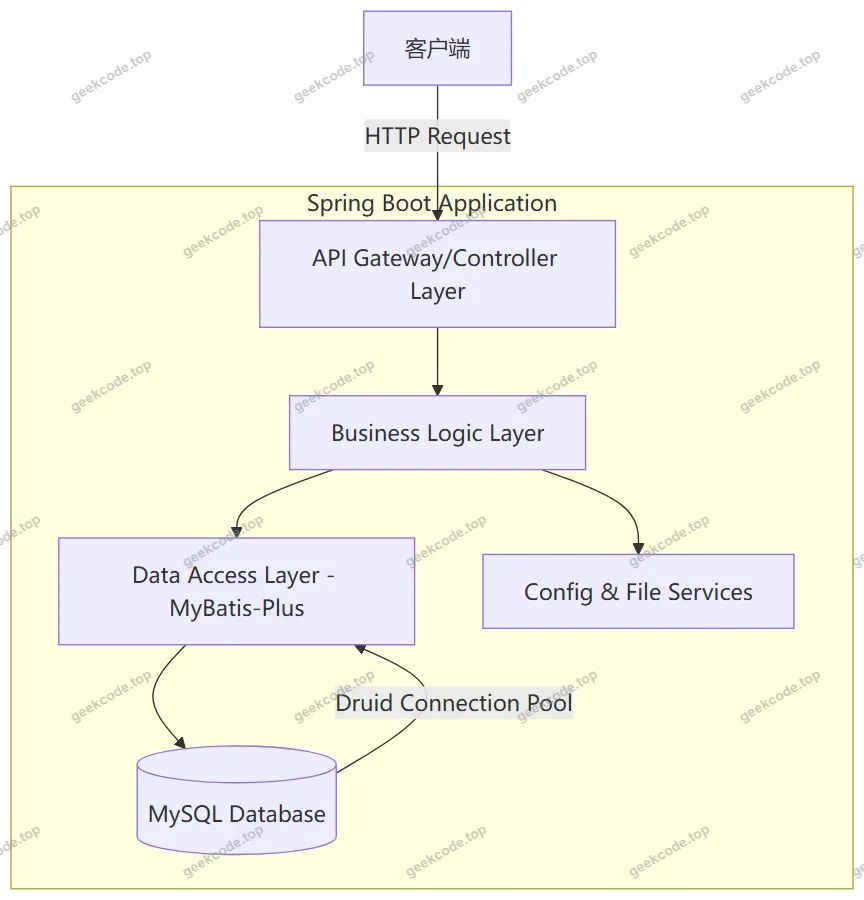
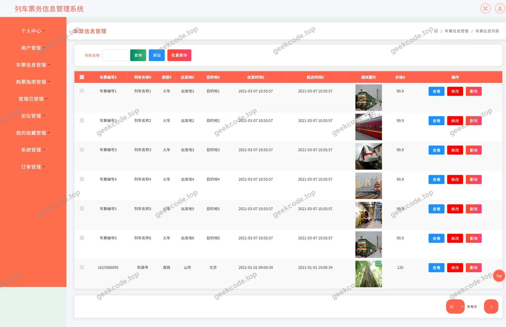
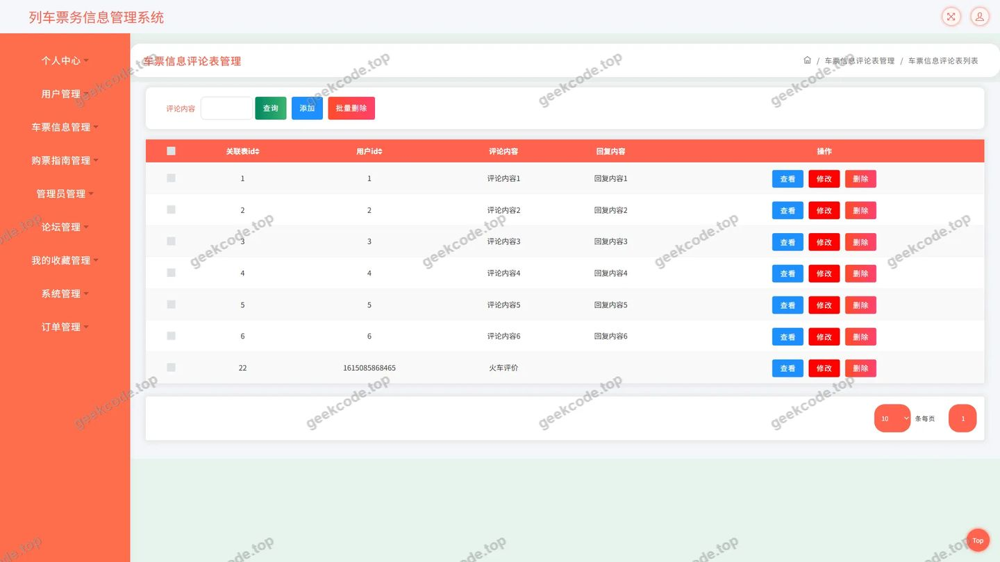
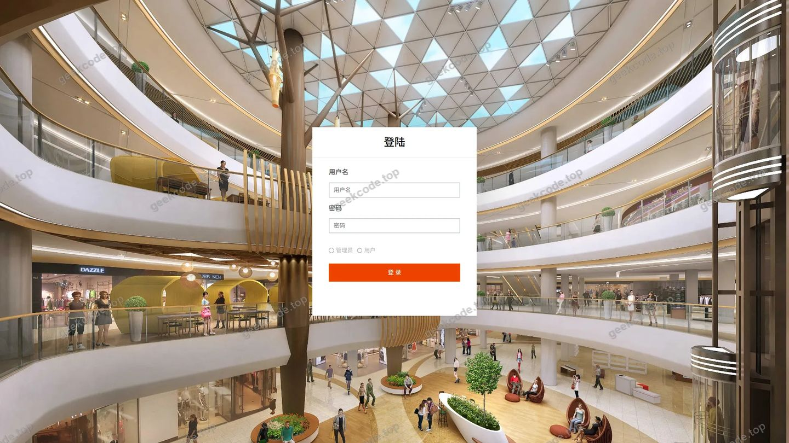
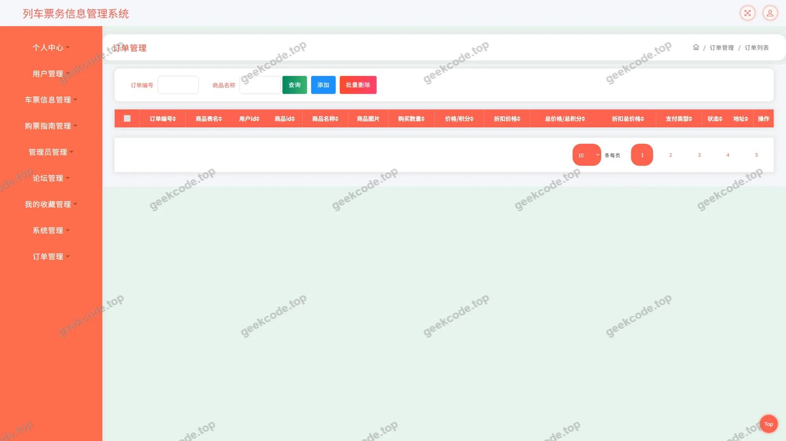
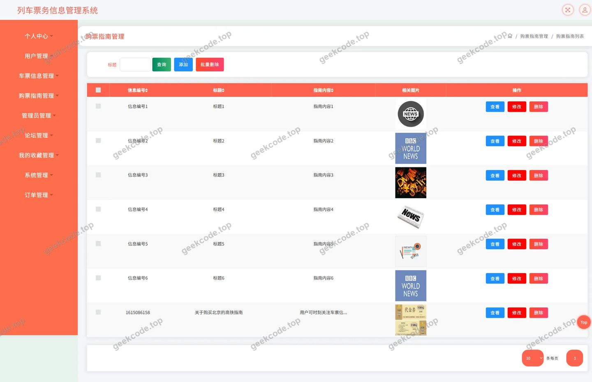
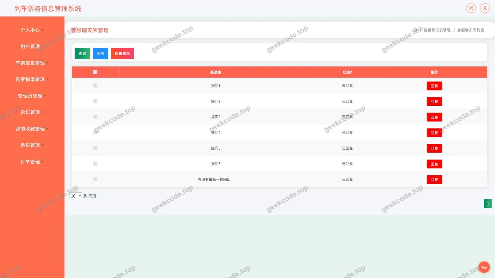
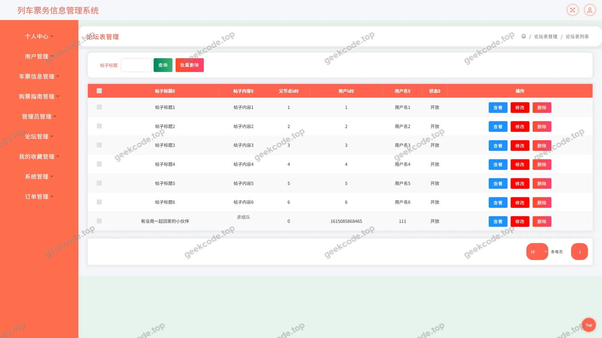
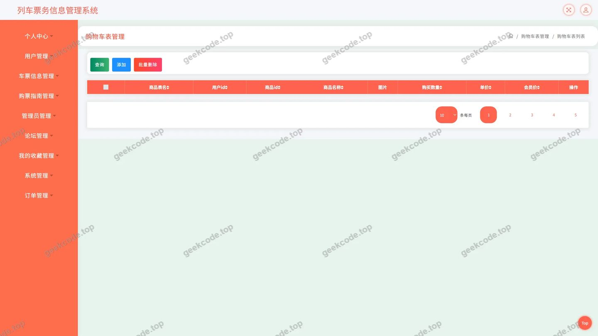

# 列车票务信息管理系统

> 🎓 **计算机毕业设计 · 列车票务信息管理系统**
>
> 本仓库只放**项目介绍 + 运行截图**（截图是站点带水印的原图，存在仓库 `images/` 里）。
>
> 👉 **完整可运行源码 / 数据库脚本 / 部署文档：[点我获取](https://geekcode.top/archives/%E5%88%97%E8%BD%A6%E7%A5%A8%E5%8A%A1%E4%BF%A1%E6%81%AF%E7%AE%A1%E7%90%86%E7%B3%BB%E7%BB%9F?utm_source=github)**
>
> 💬 咨询微信：**ir9372**　|　🌐 更多项目：[极客代码 geekcode.top](https://geekcode.top/?utm_source=github)
>
> 📌 项目详情页：<https://geekcode.top/archives/%E5%88%97%E8%BD%A6%E7%A5%A8%E5%8A%A1%E4%BF%A1%E6%81%AF%E7%AE%A1%E7%90%86%E7%B3%BB%E7%BB%9F?utm_source=github>

<table><td width="230" align="center"> <b>扫码加微信 ir9372</b></td><td valign="middle">📦 源码 = 项目介绍 + 全部运行截图 + 数据库 + 部署文档 👉 点上方任意截图，直接跳到 <b>极客代码 geekcode.top</b> 详情页</td></table>

---

<h1>列车票务信息管理系统</h1>
<h2>项目概述</h2>

本项目为列车票务信息管理系统，旨在通过数字化手段优化铁路出行服务流程，提升用户购票体验与信息获取效率。系统核心功能涵盖车票信息查询、在线下单、购票指南阅读、论坛交流及个人中心管理等模块，适用于广大铁路旅客及票务服务人员。技术架构采用基于 Spring Boot 的后端框架，结合 MyBatis-Plus 进行持久层操作，使用 Druid 作为数据库连接池，确保系统的高性能与稳定性。该系统以纯 API 接口形式提供服务，专注于业务逻辑处理与数据交互，为前端应用提供坚实的数据支撑。

<h2>技术架构</h2>

本系统采用分层架构设计，主要包含控制层、业务逻辑层和数据访问层。后端基于 Spring Framework 生态构建，利用 <code>spring-web</code> 和 <code>spring-webmvc</code> 实现 RESTful API 接口开发，通过 <code>spring-tx</code> 保证事务一致性。持久层选用 MyBatis-Plus，简化了 SQL 编写与实体映射过程，提高了开发效率。数据库连接管理采用 Alibaba Druid 连接池，具备强大的监控和扩展功能。

在代码结构上，系统定义了多个 Controller 组件，如 <code>ChepiaoxinxiController</code>（车票信息）、<code>OrdersController</code>（订单）、<code>ForumController</code>（论坛）等，分别对应不同的业务领域。依赖管理中引入了 <code>junit</code> 用于单元测试，确保代码质量。由于项目类型为 pure-api，未包含前台页面渲染或后台管理界面的具体路由配置，所有交互均通过 HTTP 请求完成数据交换。

<h2>功能模块</h2>

根据提供的导航菜单与控制器列表，系统主要功能划分为以下模块：

<h3>1. 车票信息管理模块</h3>

由 <code>ChepiaoxinxiController</code> 负责，支持车票信息的查询与展示。用户可浏览可用的列车班次、票价及相关行程信息。该模块是系统的核心业务入口，直接关联用户的出行需求。

<h3>2. 订单交易模块</h3>

由 <code>OrdersController</code> 和 <code>CartController</code> 协同工作，实现从加入购物车到生成订单的全流程管理。用户可对选定的车票进行结算，系统记录订单状态，支持订单的查看与管理。

<h3>3. 购票指南与资讯模块</h3>

由 <code>GoupiaozhinanController</code> 提供，发布官方或整理的购票攻略、注意事项等内容。同时，<code>DiscussgoupiaozhinanController</code> 允许用户对指南内容进行评论互动，增强信息的实用性与社区活跃度。

<h3>4. 论坛与交流模块</h3>

由 <code>ForumController</code> 主导，构建用户交流平台。用户可以发布帖子、分享旅行经验或提出问题。<code>ChatController</code> 可能涉及即时通讯或客服聊天功能，为用户提供实时帮助。

<h3>5. 个人用户中心模块</h3>

集成地址管理、收藏管理及个人中心功能。

<ul>
<li><strong>地址管理</strong>：<code>AddressController</code> 处理用户收货地址或常用出发地/目的地的增删改查。</li>
<li><strong>收藏管理</strong>：<code>CommonController</code> 或其他相关控制器支持用户对感兴趣的车票或指南进行收藏。</li>
<li><strong>文件服务</strong>：<code>FileController</code> 负责用户上传头像、附件等文件的存储与读取。</li>
</ul>
<h3>6. 系统基础配置模块</h3>

<code>ConfigController</code> 负责系统参数的动态配置与管理，确保系统运行的灵活性与可维护性。

<h2>用户角色与权限</h2>

根据现有源码上下文，系统主要面向普通注册用户提供服务。虽然未明确列出管理员角色的独立后台路由，但基于典型的票务系统设计及控制器命名规范，可推断存在以下角色划分：

<h3>1. 普通用户</h3>

普通用户是系统的主要使用者，拥有以下权限：

<ul>
<li><strong>浏览与查询</strong>：访问车票信息、购票指南、论坛帖子。</li>
<li><strong>交易操作</strong>：创建订单、查看我的订单、管理购物车。</li>
<li><strong>内容互动</strong>：发表论坛帖子、对车票信息和购票指南进行评论（通过 <code>DiscusschepiaoxinxiController</code> 和 <code>DiscussgoupiaozhinanController</code>）。</li>
<li><strong>个人信息管理</strong>：修改个人资料、管理我的地址、管理我的收藏、查看我的发布内容。</li>
<li><strong>客服沟通</strong>：使用客服聊天功能寻求帮助。</li>
</ul>
<h3>2. 系统管理员</h3>

尽管没有独立的后台界面路由描述，但 <code>ConfigController</code> 和 <code>FileController</code> 的存在暗示了后台管理能力。管理员通常具备以下权限：

<ul>
<li><strong>数据维护</strong>：录入、更新或删除车票信息、购票指南内容。</li>
<li><strong>用户管理</strong>：审核用户注册、处理违规内容、管理论坛帖子。</li>
<li><strong>系统配置</strong>：修改系统全局参数、管理文件存储策略。</li>
<li><strong>订单监控</strong>：查看所有用户的订单状态，处理退款或异常订单。</li>
</ul>

<em>注：具体的权限隔离机制需结合实际的安全过滤器配置确定，此处仅依据功能模块推导常规权限模型。</em>

<h2>项目特色与创新点</h2>
<ol>
<li><strong>模块化 API 设计</strong>：系统严格遵循单一职责原则，将车票、订单、论坛、地址等功能拆分为独立的 Controller 模块。这种设计使得各业务边界清晰，便于后期微服务化改造或功能扩展。</li>
<li><strong>完善的互动生态</strong>：除了基础的票务交易，系统集成了论坛、评论和客服聊天功能。<code>ChatController</code> 和各类 Discuss 控制器构建了“交易+社交”的双轮驱动模式，增强了用户粘性和平台活跃度。</li>
<li><strong>高效的数据访问层</strong>：采用 MyBatis-Plus 替代传统 MyBatis，大幅减少了样板代码的编写，同时保留了灵活的 SQL 定制能力。配合 Druid 连接池的高性能特性，能够有效应对高并发下的票务查询与下单请求。</li>
<li><strong>全面的个人中心支持</strong>：涵盖了地址、收藏、订单、发布等多维度的个人数据管理，为用户提供了个性化的服务体验，符合现代互联网产品的用户体验标准。</li>
</ol>
<h2>部署环境</h2>

为确保列车票务信息管理系统正常运行，服务器端需满足以下软件环境要求：

<ol>
<li><strong>Java 运行环境</strong>：JDK 1.8 及以上版本（推荐 JDK 8 或 JDK 11），用于编译和运行 Spring Boot 应用程序。</li>
<li><strong>数据库系统</strong>：MySQL 5.7 或 MySQL 8.0 版本，用于存储车票、用户、订单等业务数据。需配置相应的字符集（utf8mb4）以支持中文及特殊符号。</li>
<li><strong>构建工具</strong>：Maven 3.6+ 或 Gradle，用于项目的依赖管理和打包构建。</li>
<li><strong>操作系统</strong>：Linux (CentOS 7/8, Ubuntu 18.04+) 或 Windows Server，建议生产环境使用 Linux 以获得更好的稳定性和资源利用率。</li>
<li><strong>Web 容器</strong>：内置 Tomcat（Spring Boot 默认集成），无需单独安装外部 Web 服务器，除非需要反向代理配置（如 Nginx）。</li>
</ol>

<em>注意：由于项目为 pure-api 类型且无前台/后台路由信息，前端部署所需的 Node.js 环境或静态资源服务器配置不在本次文档讨论范围内，仅关注后端服务的运行依赖。</em>

<h2>五、技术特性</h2>
<ul>
<li>使用 MyBatis-Plus 简化数据访问层开发</li>
</ul>
<h2>六、功能模块截图</h2>
<h3>后台管理端</h3>
<h4>页面-车票信息</h4>

<h4>页面-车票信息评论</h4>

<h4>页面-登录</h4>

<h4>页面-订单</h4>

<h4>页面-购票指南</h4>

<h4>页面-购票指南评论</h4>

<h4>页面-客服聊天</h4>

<h4>页面-论坛</h4>

<h4>页面-用户</h4>

---

## 获取完整源码

| 项目 | 说明 |
| --- | --- |
| 项目名 | 列车票务信息管理系统 |
| 运行截图 | 本文 10 张（站点带水印原图，仓库 `images/` 目录） |
| 完整源码 | [https://geekcode.top/archives/%E5%88%97%E8%BD%A6%E7%A5%A8%E5%8A%A1%E4%BF%A1%E6%81%AF%E7%AE%A1%E7%90%86%E7%B3%BB%E7%BB%9F?utm_source=github](https://geekcode.top/archives/%E5%88%97%E8%BD%A6%E7%A5%A8%E5%8A%A1%E4%BF%A1%E6%81%AF%E7%AE%A1%E7%90%86%E7%B3%BB%E7%BB%9F?utm_source=github) |
| 咨询微信 | **ir9372**（备注：jingpin-yuanma） |
| 更多项目 | [极客代码 geekcode.top](https://geekcode.top/?utm_source=github) |

> 需要源码、部署、改配置、跑不起来等问题，加微信 ir9372 沟通，说明项目名即可。
